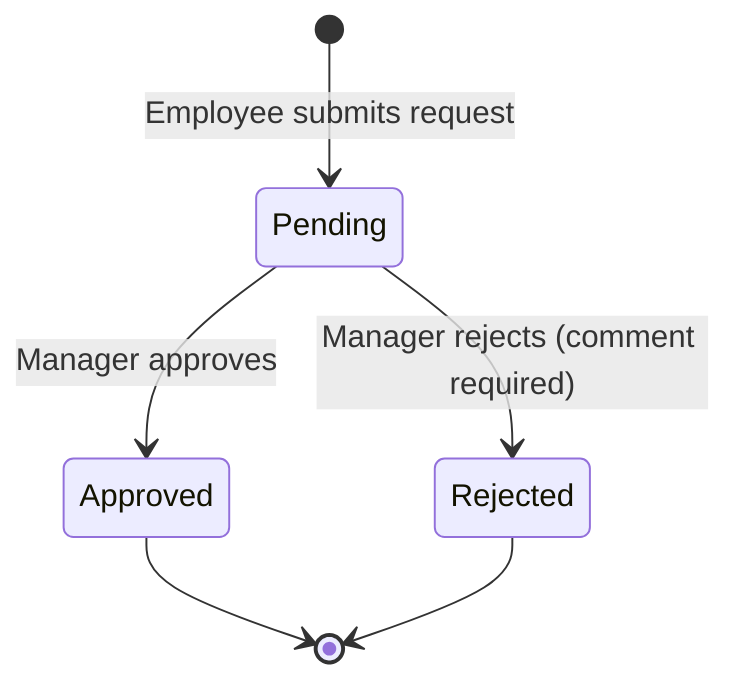
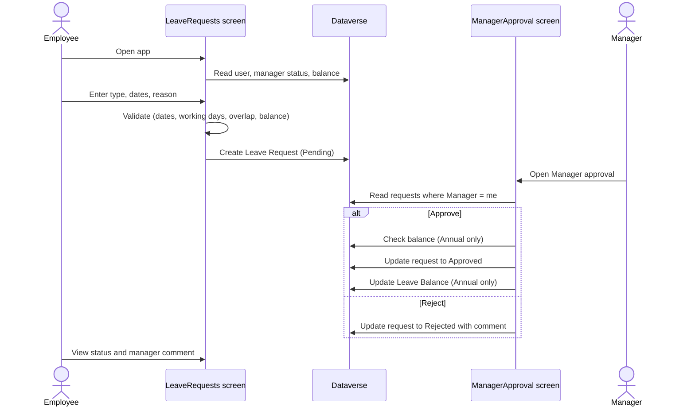

# Application workflow

## 1. Request life cycle

## 2. End-to-end sequence

## 3. Responsibilities
| Step | Actor | Screen | Data change |
|---|---|---|---|
| 1 | Employee | LeaveRequests | Leave Requests row created: Pending, Balance Deducted = No |
| 2 | Manager | ManagerApproval | request set to Approved or Rejected with comment and time |
| 3 | System (Power Fx) | ManagerApproval | Annual approvals only: Leave Balances row updated, Balance Deducted = Yes |
| 4 | Employee | LeaveRequests | reads status and comment (no change) |

## 4. Rules summary
- One manager per employee, taken from the Dataverse **Manager** field.
- A manager never approves his or her own request (own requests are excluded from the list).
- Only Pending requests can be decided; decisions are final in the application.
- Rejection needs a comment; approval comment is optional.
- Only approved Annual leave changes a balance.
