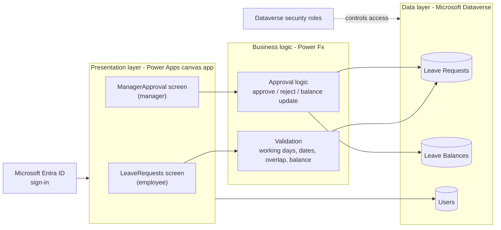

# System architecture

## 1. Overview
The system follows a three-layer design. A **Power Apps canvas app** provides the user interface, **Power Fx** holds all business logic inside the app, and **Microsoft Dataverse** stores the data and enforces access through security roles. Users sign in with their Microsoft Entra ID work or school account; the app reads that identity with `User()` and matches it to the Dataverse `Users` table.

## 2. Components
| Layer | Component | Responsibility |
|---|---|---|
| Presentation | Screen `LeaveRequests` | leave balance summary, request form, employee's own request list |
| Presentation | Screen `ManagerApproval` | manager dashboard counters, list of team requests, approve / reject with comment |
| Logic | Power Fx formulas (`src/powerfx`) | working-day calculation, validation, overlap warning, approval, balance update |
| Data | Table `Leave Requests` | one row per leave request and its decision |
| Data | Table `Leave Balances` | one row per employee per year |
| Data | Table `Users` (Dataverse system table) | employees, e-mail address and the **Manager** relationship |
| Security | Dataverse security roles | who can create, read or update each table |
| Automation | `dataverse/*.py` | creates the tables and loads sample data through the Dataverse Web API |

## 3. Data flow
1. The employee opens the app; `App.OnStart` resolves the user, manager status and balance record.
2. On *Submit*, the `LeaveRequests` screen validates the input in Power Fx and creates a `Leave Requests` row with status **Pending**.
3. The manager opens `ManagerApproval`; the gallery filters rows where the manager is the signed-in user.
4. On *Approve* the app updates the request and, for Annual leave, the employee's `Leave Balances` row. On *Reject* only the request is updated.
5. The employee sees the new status and the manager's comment in *My leave requests*.

## 4. Design decisions
| Decision | Reason |
|---|---|
| All logic in Power Fx, no cloud flows | keeps the solution small and fully visible inside one app; suitable for a two-screen application |
| Manager identified through the Dataverse **Manager** field of the user | uses the platform's own hierarchy instead of a custom mapping table |
| Choice columns for *Leave Type* and *Leave Status* | consistent values and enum-style formulas such as `'LMS Leave Status'.Approved` |
| `Balance Deducted` flag on each request | records whether a request has changed the balance, making the balance auditable and protecting against double deduction |
| Balance changed only when a request is approved | pending or rejected requests never consume leave |
| Audit enabled on both tables | changes to statuses and balances are traceable in Dataverse |
