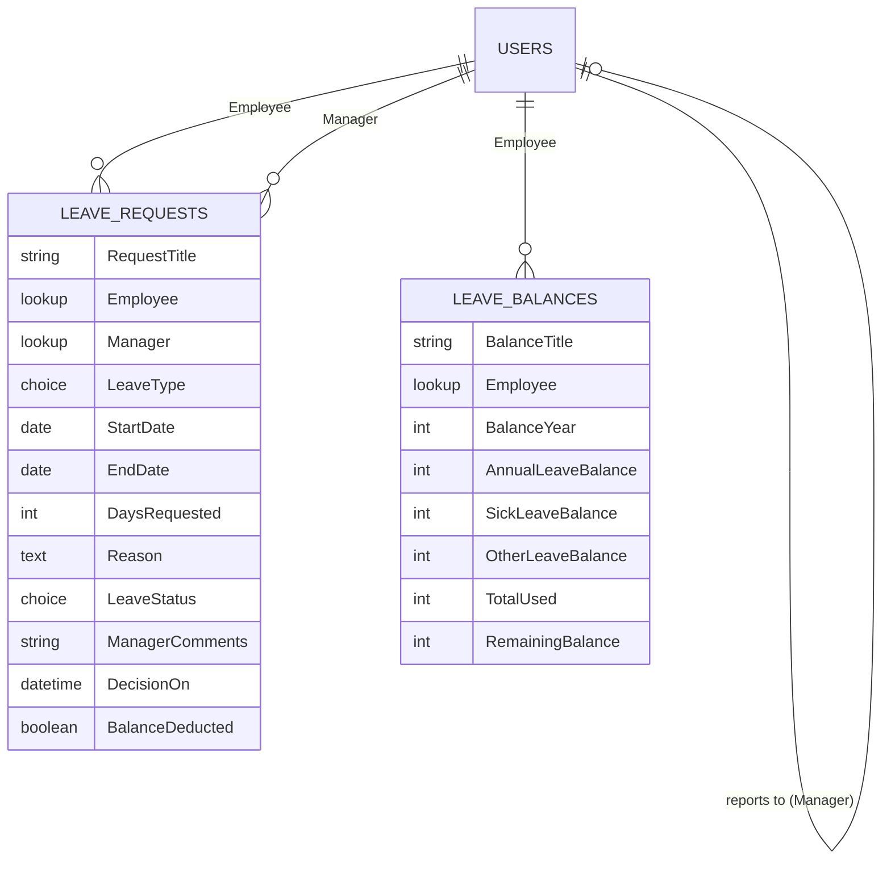

# Dataverse tables

The data model has two custom tables, **Leave Requests** and **Leave Balances**, both related to the Dataverse system table **Users**. In the table below `<prefix>` is the publisher prefix of your solution (the scripts default to `lrs`).

## 1. Table: Leave Requests (`<prefix>_leaverequest`)
Ownership: user-owned - Auditing: enabled.

| Display name | Logical name | Data type | Required | Description |
|---|---|---|---|---|
| Request Title | `<prefix>_requesttitle` | Text (200), primary name | Yes | generated as *"Annual leave - 21 Dec 2026"* |
| Employee | `<prefix>_employee` | Lookup -> Users | Yes | employee who requests leave |
| Manager | `<prefix>_manager` | Lookup -> Users | No | approver; copied from the employee's Manager field on submission |
| Leave Type | `<prefix>_leavetype` | Choice `LMS Leave Type` | Yes | Annual, Sick, Others |
| Start Date | `<prefix>_startdate` | Date only | Yes | first day of leave |
| End Date | `<prefix>_enddate` | Date only | Yes | last day of leave (not before start date) |
| Days Requested | `<prefix>_daysrequested` | Whole number (0-365) | Yes | working days (Mon-Fri) between start and end date |
| Reason | `<prefix>_reason` | Multiple lines (2000) | Yes | employee's reason |
| Leave Status | `<prefix>_leavestatus` | Choice `LMS Leave Status` | Yes | Pending (default), Approved, Rejected |
| Manager Comments | `<prefix>_managercomments` | Text (500) | No | comment on the decision; mandatory when rejecting |
| Decision On | `<prefix>_decisionon` | Date and time | No | when the manager approved or rejected |
| Balance Deducted | `<prefix>_balancededucted` | Yes/No (default No) | No | Yes when the approval reduced the annual balance |

## 2. Table: Leave Balances (`<prefix>_leavebalance`)
Ownership: user-owned - Auditing: enabled. One row per employee per calendar year.

| Display name | Logical name | Data type | Required | Description |
|---|---|---|---|---|
| Balance Title | `<prefix>_balancetitle` | Text (200), primary name | Yes | for example *"Fatima Rahman - 2026"* |
| Employee | `<prefix>_employee` | Lookup -> Users | Yes | owner of the balance |
| Balance Year | `<prefix>_balanceyear` | Whole number (2000-2100) | Yes | calendar year |
| Annual Leave Balance | `<prefix>_annualleavebalance` | Whole number | Yes | annual leave days still available; **reduced by approved Annual leave** |
| Sick Leave Balance | `<prefix>_sickleavebalance` | Whole number | Yes | sick leave entitlement; not reduced by the app |
| Other Leave Balance | `<prefix>_otherleavebalance` | Whole number | Yes | other leave entitlement; not reduced by the app |
| Total Used | `<prefix>_totalused` | Whole number | Yes | annual leave days taken this year |
| Remaining Balance | `<prefix>_remainingbalance` | Whole number | Yes | sum of the three balance columns, reduced together with *Annual Leave Balance* |

## 3. Choices
| Choice (display name) | Logical name | Values |
|---|---|---|
| LMS Leave Type | `<prefix>_leavetype` | Annual = 100000000, Sick = 100000001, Others = 100000002 |
| LMS Leave Status | `<prefix>_leavestatus` | Pending = 100000000, Approved = 100000001, Rejected = 100000002 |

## 4. Relationships
| From | To | Column | Behaviour |
|---|---|---|---|
| Leave Requests (many) | Users (one) | Employee | delete restricted |
| Leave Requests (many) | Users (one) | Manager | delete restricted |
| Leave Balances (many) | Users (one) | Employee | delete restricted |
| Users (many) | Users (one) | Manager (system column) | defines the reporting line used for routing |

## 5. Creating the tables
`dataverse/create_schema.py` creates every object above inside your unmanaged solution; see [setup-guide.md](setup-guide.md). Access control is described in [security-and-roles.md](security-and-roles.md).
