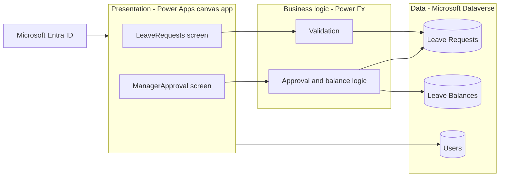
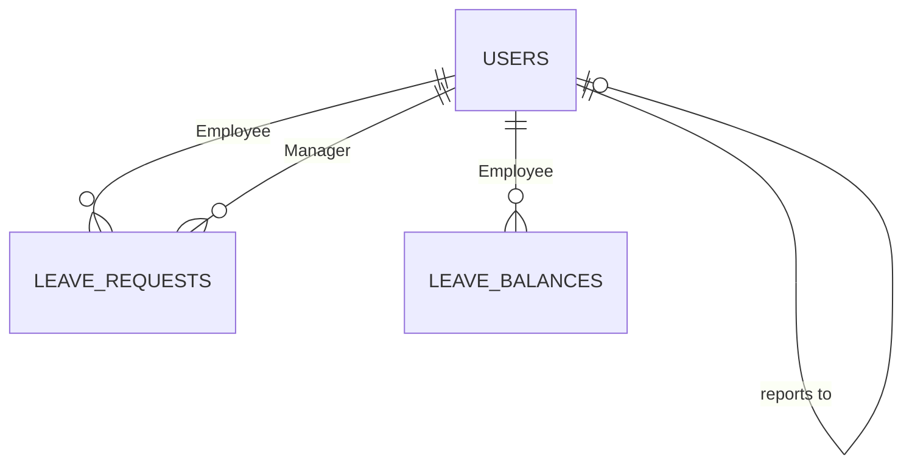
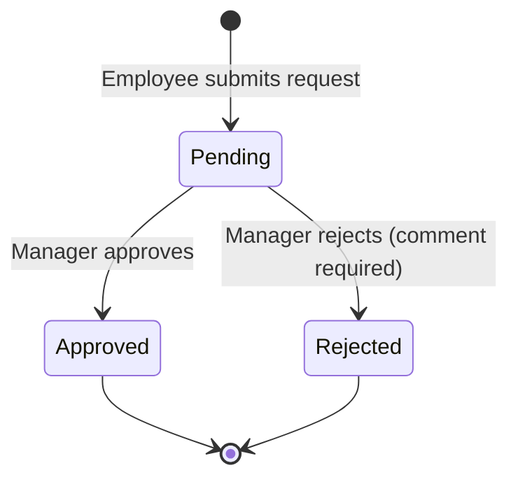

# Leave Request & Approval Management System

A Microsoft Power Apps canvas application, backed by Microsoft Dataverse and built with Power Fx, that lets employees request leave and managers approve or reject it, with automatic leave balance management.

| | |
|---|---|
| **Project title** | Leave Request & Approval Management System |
| **Author** | Haniya |
| **Platform** | Microsoft Power Apps (canvas app), Microsoft Dataverse |
| **Language** | Power Fx (formulas), Python (Dataverse set-up scripts) |

---

## Table of contents
1. [Introduction](#1-introduction)
2. [Abstract](#2-abstract)
3. [Objectives](#3-objectives)
4. [Features](#4-features)
5. [Technologies used](#5-technologies-used)
6. [System architecture](#6-system-architecture)
7. [Modules](#7-modules)
8. [Database description](#8-database-description)
9. [Application workflow](#9-application-workflow)
10. [Installation and setup](#10-installation-and-setup)
11. [Repository structure](#11-repository-structure)


---

## 1. Introduction
Organisations that manage leave through e-mail, paper forms or spreadsheets struggle with lost requests, unclear status, manual balance calculation and no record of who approved what. The **Leave Request & Approval Management System** replaces that process with a single low-code application. Employees submit leave requests from the **LeaveRequests** screen; managers review them on the **ManagerApproval** screen. All data is stored in two Dataverse tables, **Leave Requests** and **Leave Balances**, and all rules are implemented in Power Fx.

## 2. Abstract
This project presents a leave management application developed on the Microsoft Power Platform. The front end is a two-screen canvas app; the back end is Microsoft Dataverse, which stores leave requests and yearly leave balances and controls access through security roles. Employees apply for Annual, Sick or Other leave, and the app validates the dates, calculates the number of working days, warns about overlapping requests and checks the annual balance before the request is saved. Each request is routed to the employee's manager, identified through the Dataverse reporting line. Managers see counters and a list of their team's requests and can approve or reject pending requests; rejection requires a comment. Approving an Annual request automatically reduces the employee's annual leave balance, whereas Sick and Other leave leave the balances unchanged. A flag on every request records whether the balance was affected, and the application reverts an approval if the balance update fails, keeping the data consistent. The project demonstrates relational data modelling in Dataverse, formula-based business logic in Power Fx and role-based access control.

## 3. Objectives
1. Provide a single, simple place for employees to request leave and follow its status.
2. Route every request to the correct manager automatically.
3. Allow managers to approve or reject pending requests, with comments recorded for the employee.
4. Maintain accurate yearly leave balances without manual calculation.
5. Prevent invalid requests through validation of dates, working days, overlaps and available balance.
6. Store all data in a secure, auditable, relational data model with role-based access.
7. Document the design, data model and formulas so that the system can be understood, reproduced and maintained.

## 4. Features
**Employee**
- Leave balance summary for the current year (annual, sick, other, annual days used)
- Request form for Annual, Sick and Other leave
- Automatic working-day calculation (Monday to Friday)
- Date validation, balance check, overlap warning with confirmation
- "My leave requests" list with colour-coded status and the manager's comment

**Manager**
- Dashboard counters for Pending, Approved and Rejected requests
- List of the team's requests with a status view selector
- One-click approval; rejection with a mandatory comment
- Approval re-checks the annual balance before it is granted

**Data and security**
- Two Dataverse tables with lookups to the Users table and choice columns for type and status
- Automatic annual balance deduction on approval (Annual leave only)
- `Balance Deducted` flag, automatic rollback and Dataverse auditing
- Role-based access with security roles; managers never see their own requests in the approval list

## 5. Technologies used
| Technology | Purpose |
|---|---|
| Microsoft Power Apps (canvas app) | user interface with two screens |
| Microsoft Dataverse | relational data storage, security roles, auditing |
| Power Fx | validation, calculations, approval and balance logic |
| Microsoft Entra ID | user sign-in and identity (`User()`) |
| Python 3 and Dataverse Web API | scripted creation of the tables and loading of sample data |
| GitHub and GitHub Actions | version control and automatic repository checks |
| Mermaid | diagrams in the documentation |

## 6. System architecture

The app authenticates the user with Entra ID, applies the rules in Power Fx and reads and writes Dataverse tables under the user's security role. See [docs/architecture.md](docs/architecture.md).

## 7. Modules
| Module | Screen / component | Description | Documentation |
|---|---|---|---|
| Employee leave request submission | `LeaveRequests` | balance summary, request form, validation, overlap warning, request history | [docs/employee-leave-request-submission.md](docs/employee-leave-request-submission.md) |
| Manager approval and rejection | `ManagerApproval` | counters, team request list, approve / reject with comment | [docs/manager-approval-and-rejection.md](docs/manager-approval-and-rejection.md) |
| Leave balance management | Power Fx + `Leave Balances` | yearly balances, deduction of approved Annual leave, safeguards | [docs/leave-balance-management.md](docs/leave-balance-management.md) |
| Data module | Dataverse tables | tables, columns, choices, relationships | [docs/dataverse-tables.md](docs/dataverse-tables.md) |
| Security module | Dataverse roles | employee, manager and administrator privileges | [docs/security-and-roles.md](docs/security-and-roles.md) |

## 8. Database description
Two custom tables are related to the Dataverse **Users** table.



| Table | Purpose | Main columns |
|---|---|---|
| **Leave Requests** | one row per request and decision | Employee, Manager, Leave Type, Start Date, End Date, Days Requested, Reason, Leave Status, Manager Comments, Decision On, Balance Deducted |
| **Leave Balances** | one row per employee per year | Employee, Balance Year, Annual / Sick / Other Leave Balance, Total Used, Remaining Balance |

Choices: **Leave Type** = Annual, Sick, Others; **Leave Status** = Pending, Approved, Rejected. The complete data dictionary is in [docs/dataverse-tables.md](docs/dataverse-tables.md).

**Balance rule:** an approved *Annual* request reduces *Annual Leave Balance* and *Remaining Balance* and increases *Total Used*; *Sick* and *Others* do not change the balances.

## 9. Application workflow

1. The employee submits a request; it is validated and saved as **Pending** with the employee's manager.
2. The manager opens **Manager approval**, reviews the request and approves or rejects it.
3. On approval of Annual leave the balance is updated; on rejection nothing else changes.
4. The employee sees the status and comment in *My leave requests*.

Details and sequence diagram: [docs/application-workflow.md](docs/application-workflow.md). Formula reference: [docs/power-fx-formulas.md](docs/power-fx-formulas.md).

## 10. Installation and setup
Short version (full guide: [docs/setup-guide.md](docs/setup-guide.md)):
1. **Environment** - a Power Platform environment with a Dataverse database; Python 3.9+.
2. **Solution** - create the solution `LeaveManagement` with a publisher prefix (for example `lrs`) in make.powerapps.com.
3. **Tables** - run the schema script:
   ```bash
   pip install -r dataverse/requirements.txt
   cd dataverse
   export DATAVERSE_URL=https://yourorg.crm.dynamics.com
   export SOLUTION_UNIQUE_NAME=LeaveManagement
   export PUBLISHER_PREFIX=lrs
   python create_schema.py
   ```
4. **Security** - create and assign the roles in [docs/security-and-roles.md](docs/security-and-roles.md); set each user's Manager.
5. **App** - create a canvas app with screens `LeaveRequests` and `ManagerApproval`, add the three data sources, paste `src/powerfx/App.OnStart.fx` and the two screen files from `src/powerfx/screens/`.
6. **Sample data (optional)** - edit `sample-data/*.csv` for your users and run `python seed_sample_data.py`.
7. **Share** the app with the employees' group.

## 11. Repository structure
```
Leave-Request-and-Approval-Management-System/
├── README.md
├── LICENSE
├── .gitignore
├── .github/workflows/validate.yml      automatic repository checks
├── docs/
│   ├── architecture.md
│   ├── dataverse-tables.md
│   ├── employee-leave-request-submission.md
│   ├── manager-approval-and-rejection.md
│   ├── leave-balance-management.md
│   ├── application-workflow.md
│   ├── power-fx-formulas.md            generated from src/powerfx
│   ├── security-and-roles.md
│   ├── setup-guide.md
│   └── screenshots/README.md
├── src/powerfx/
│   ├── App.OnStart.fx
│   └── screens/
│       ├── LeaveRequests.fx.yaml
│       └── ManagerApproval.fx.yaml
├── dataverse/
│   ├── create_schema.py
│   ├── seed_sample_data.py
│   ├── _common.py
│   └── requirements.txt
├── sample-data/
│   ├── sample_users.csv
│   └── sample_requests.csv
└── scripts/
    ├── build_formula_docs.py
    └── validate_repository.py
```


